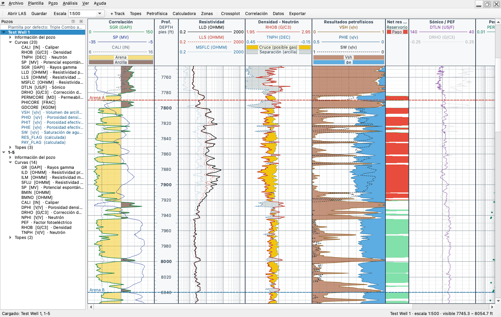
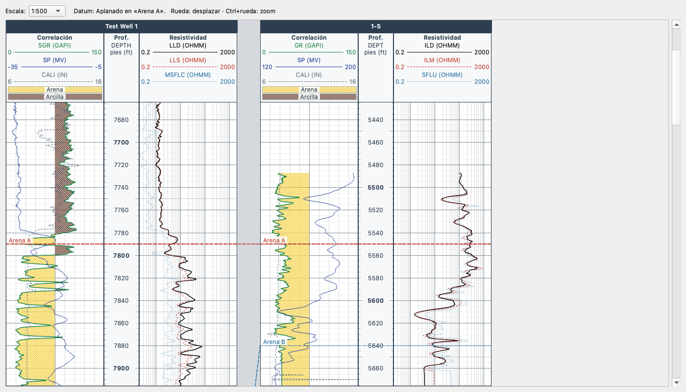
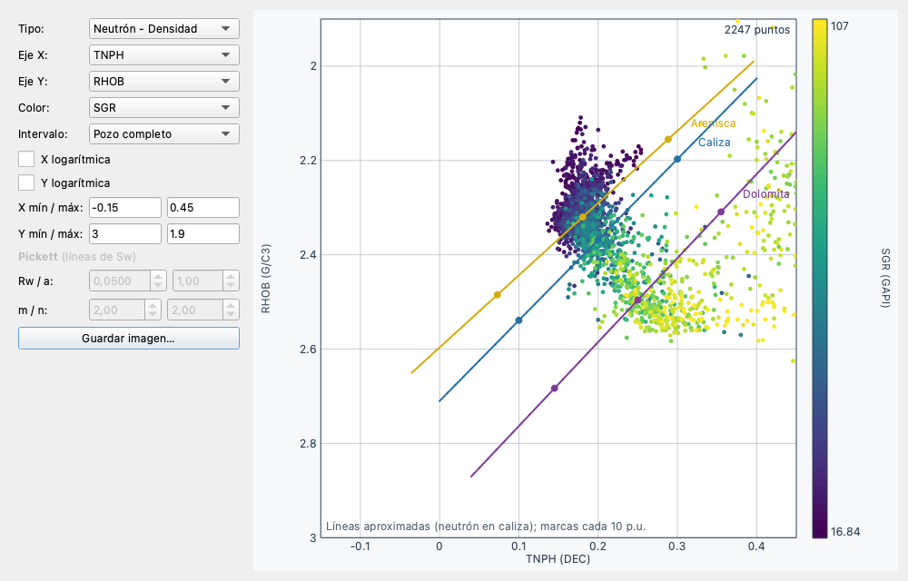

# InnoPetrol — Visor de Pozos

Visor de registros de pozo (archivos **LAS 2.0**) para ingenieros de petróleo, escrito en Python con PySide6.

*[English](README.md) · Español*



## Funciones

**Visualización**
- Varios pozos abiertos a la vez (ventanas o pestañas), árbol lateral con cabecera, curvas y topes.
- Plantilla automática **Triple Combo** al abrir un LAS: correlación (GR/SP/CALI con relleno arena-arcilla), profundidad, resistividades (log), densidad-neutrón con cruce de gas, sónico/PEF, petrofísica y permeabilidad.
- Reconoce unos 125 mnemónicos (17 familias de curvas) de distintas compañías de servicio (GR/SGR/GRC, NPHI/TNPH, LLD/ILD/AT90…) y propone escala, color y tipo lineal/log.
- Escalas verticales reales (1:200, 1:500, 1:1000…) o ajuste a la ventana.
- Tracks configurables: curvas, escala lineal o logarítmica, color, grosor, estilo, rellenos entre curvas o contra un valor fijo con 10 patrones.
- **Escalas de respaldo (wrap-around)**: los valores fuera de escala se dibujan de nuevo, a trazos, en el ancho siguiente (GR 150–300).
- **Rellenos con color por valor** (paletas rayos gamma, resistividad, viridis, arcoíris, grises).
- **Track de volúmenes**: arcilla / matriz / hidrocarburo / agua apilados, a partir de la petrofísica.
- Agregar, quitar, mover, renombrar y cambiar el ancho de tracks (arrastrando el borde).
- **Unidades a demanda**: Ver ▸ Sistema de unidades (como en el archivo / petrolero / métrico) o por curva desde
  el árbol del pozo (g/cm³ ↔ kg/m³, µs/ft ↔ µs/m, fracción ↔ %, °F ↔ °C, psi ↔ kPa, in ↔ mm). Los datos guardados
  nunca cambian y los cálculos convierten sus entradas, así que el resultado no depende de cómo vino cada archivo.
- Interfaz en **español o inglés**, se cambia en vivo desde **Ver ▸ Language / Idioma** (al primer arranque usa el idioma del sistema).

**Navegación** (en Mac, ⌘ en lugar de Ctrl)
- Zoom: botones **−** / **+** junto a «Escala» (o Ctrl − / Ctrl +) saltan entre escalas estándar; «Ajustar» muestra el pozo completo (Ctrl 0); en el campo «Escala» se puede escribir una exacta, p. ej. `1:300`.
- Zoom continuo en el cursor: Ctrl + rueda o pellizco en el trackpad.
- Rueda: desplazar · Shift + rueda: horizontal · RePág/AvPág, Inicio/Fin.
- Cursor con lectura de profundidad, zona y valor de todas las curvas en la barra de estado.
- Tabla de datos sincronizada con el cursor.

**Interpretación**
- Topes de formación: agregar con clic derecho, editar en tabla, importar/exportar CSV (columnas en español o inglés).
- Petrofísica: Vsh (lineal, Larionov), porosidad densidad y neutrón-densidad, porosidad efectiva, Sw por **Archie, Simandoux o Indonesia**, banderas de reservorio y pago.
- **Parámetros por zona** (entre topes): GR limpio/arcilla, densidad de matriz y fluido, Rw, a, m, n, Rsh y cortes.
- **Rw a temperatura de formación** (Arps) con gradiente geotérmico sobre TVD o con una curva de temperatura.
- **Elección gráfica de parámetros**: GR limpio/arcilla arrastrando líneas sobre el histograma y Rw arrastrando la línea de agua en el gráfico de Pickett (o ajustándola a los puntos limpios más húmedos), para todo el pozo o una zona.
- **Control de calidad de curvas**: bandera de pozo malo (caliper − trépano, |DRHO|) que excluye densidad y neutrón de los cálculos donde el pozo está derrumbado; edición de curvas (corrimiento de profundidad, quitar picos con Hampel, mediana móvil, suavizado) como curvas nuevas con fórmula; **normalización de una curva entre pozos** (dos puntos, por zona, contra un pozo de referencia).
- **Resultados verificables**: cada ecuación con su referencia bibliográfica (Ayuda ▸ Ecuaciones y referencias, y un «?» junto a cada método); una **planilla de verificación** (.xlsx) que recalcula Vsh, φ y Sw con fórmulas de planilla al lado de los valores de InnoPetrol; un **reporte de calidad** después de calcular (Sw mayor que 1 antes de limitar, porosidad negativa, densidades imposibles…, por zona).
- **Deshacer / rehacer** (Ctrl+Z / Ctrl+Shift+Z) en cambios de tracks, plantillas, topes, survey, curvas y petrofísica, con un historial por pozo.
- Resumen por zonas: espesor bruto, neto de reservorio, neto de pago, N/G, φ, Sw y Vsh promedio (copiar a Excel o CSV).
- Calculadora de curvas con expresiones (`(2.65 - RHOB) / 1.65`, `where(GR > 75, 1, 0)`) evaluadas de forma segura.
- Estadísticas e histograma por curva y zona (P10/P50/P90).
- Crossplots con color por una tercera curva: libre, **neutrón-densidad** con líneas de litología y **Pickett** con líneas de Sw.
- **Mapa base** con la ubicación de los pozos (del encabezado o ingresada a mano, X/Y o latitud/longitud,
  decimal o grados-minutos-segundos) y las trayectorias del survey; clic en los pozos para elegir una sección
  de correlación.
- **Crossplots e histogramas multipozo**: curvas emparejadas por nombre o familia y convertidas a unidades
  comunes, zonas por nombre de tope, color por pozo, P10/P50/P90 por pozo.
- **Correlación multi-pozo** lado a lado, en profundidad o **aplanada en un tope**, con líneas que unen topes del mismo nombre.
  **Picado de topes con clic** en cada pozo (mismo nombre y color en todos, clic derecho para agregar o quitar, Ctrl+Z).

**Archivos**
- Plantillas en JSON (`.ipt.json`): se aplican a otros pozos aunque usen otros mnemónicos. Plantilla por defecto configurable.
- Proyectos (`.ipproj`): pozos, layouts, topes, parámetros y curvas calculadas (guardadas como fórmulas).
- **Autoguardado y recuperación**: el trabajo sin guardar se guarda cada 2 minutos y se ofrece recuperarlo
  tras un cierre inesperado. Los errores quedan en un archivo de registro y se informan sin cerrar el programa.
- **Alias de mnemónicos** editables por el usuario (Plantilla ▸ Alias de mnemónicos…), que se importan y
  exportan en JSON para compartir la nomenclatura de una compañía.
- Exportar el registro a **PDF paginado** o **PNG** a escala, con **encabezado de registro** (compañía, campo, compañía de servicio, referencia de profundidad, elevación, survey), **LAS** (con curvas calculadas) y **CSV**.

| Correlación aplanada en un tope | Crossplot neutrón-densidad |
|---|---|
|  |  |

## Instalación y uso

Funciona en **Windows 10/11**, **Linux** (distribuciones con glibc 2.28 o más nueva: Ubuntu 20.04+,
Debian 11+, RHEL/Rocky 8+) y **macOS 12+**. No necesita tarjeta gráfica dedicada.

### Ejecutable (sin instalar Python)

En la pestaña **Actions** del repositorio en GitHub, cada versión genera por sistema: un **instalador
de Windows** (`…-windows-setup.exe`, no requiere permisos de administrador), una **imagen de disco de
macOS** (`.dmg`, arrastrar a Aplicaciones) y un **archivo para Linux** (`.tar.gz` con `install.sh`), además
de los `.zip` simples.

Los ejecutables todavía no están firmados: SmartScreen de Windows advierte la primera vez («Más
información» ▸ «Ejecutar de todas formas») y macOS pide abrirlo con clic derecho ▸ Abrir. Qué hace falta
para firmarlos está en [docs/DISTRIBUTION.md](docs/DISTRIBUTION.md).

Para generarlo a mano en la máquina de destino:

```bash
uv sync --group build
uv run --group build python packaging/build.py     # resultado en dist/
```

### Desde el código fuente

Requiere [uv](https://docs.astral.sh/uv/), que instala Python y las dependencias automáticamente:

```bash
uv sync
uv run innopetrol                          # abre la aplicación
uv run innopetrol samples/Testdata.las     # abre directamente uno o más LAS
```

En Windows (PowerShell) se instala uv con `irm https://astral.sh/uv/install.ps1 | iex`.

En Linux, Qt necesita algunas librerías del sistema que suelen estar instaladas en escritorios;
en una instalación mínima de Ubuntu/Debian:

```bash
sudo apt install libegl1 libgl1 libxkbcommon0 libxkbcommon-x11-0 libxcb-cursor0 libfontconfig1 libdbus-1-3
```

También se pueden arrastrar archivos `.las` o `.ipproj` a la ventana. En `samples/` hay cuatro pozos de ejemplo.

### Equipos de menor potencia

La aplicación mide cuánto tarda en dibujar en cada máquina. Si un dibujo completo es lento, durante el
zoom, el cambio de tamaño de la ventana o el arrastre del borde de un track muestra una vista previa
liviana y dibuja con calidad completa al terminar el gesto. Mover el cursor y desplazarse reutilizan
lo ya dibujado, así que se mantienen fluidos también en equipos modestos.

## Desarrollo

```bash
uv sync && uv run pre-commit install
uv run pytest            # pruebas (sin abrir ventanas)
uv run ruff check && uv run ruff format --check && uv run mypy
uv run pytest -m realdata             # ~1500 LAS reales del Kansas Geological Survey (se descargan una vez)
uv run python tools/realdata.py --folder RUTA   # la misma revisión sobre sus propios LAS/DLIS
```

[CONTRIBUTING.md](CONTRIBUTING.md) (en inglés) explica las convenciones y trae recetas paso a paso: nueva
familia de curvas, tipo de track, modelo petrofísico, idioma, acción. [docs/ARCHITECTURE.md](docs/ARCHITECTURE.md)
describe las capas, el flujo de datos, las invariantes (datos siempre en MD y en las unidades del archivo,
deshacer por instantáneas…) y qué código es crítico para el rendimiento.

Las pruebas de interfaz corren sin abrir ventanas (modo *offscreen*). GitHub Actions las ejecuta en
Windows, Linux y macOS en cada cambio, y además construye y prueba el ejecutable de cada sistema
(`.github/workflows/ci.yml`).

## Estructura

```
innopetrol/
  model/     datos y cálculos puros (sin Qt): pozo, LAS/DLIS, unidades, survey, vista de profundidad,
             layout, plantillas, mnemónicos, calculadora, petrofísica, topes, ubicación, proyecto
  render/    dibujo con QPainter, compartido por la pantalla y la exportación PDF/PNG
  ui/        ventanas, diálogos y widgets PySide6; sesión (proyecto, autoguardado)
  locale/    traducciones de la interfaz (gettext: .po editable + .mo compilado)
tests/       pruebas automáticas (pytest + pytest-qt)
packaging/   ejecutables e instaladores (PyInstaller, Inno Setup, DMG, tar.gz)
tools/       mantenimiento de los catálogos de traducción
docs/        arquitectura, roadmap, distribución
samples/     archivos LAS de ejemplo
```

Para agregar un idioma, ver la sección *Adding a language* del [README en inglés](README.md#adding-a-language).

Para la historia del proyecto y qué cambió respecto de la versión de 2020, ver [CAMBIOS.md](CAMBIOS.md).

## Licencia

InnoPetrol es software libre: se puede redistribuir y modificar bajo los términos de la
**Licencia Pública General Reducida de GNU (LGPL), versión 3 o posterior** (ver
[COPYING.LESSER](COPYING.LESSER) y [COPYING](COPYING)). Se distribuye SIN NINGUNA GARANTÍA.

Componentes de terceros: Qt for Python / PySide6 (LGPLv3), lasio (MIT), NumPy (BSD).
