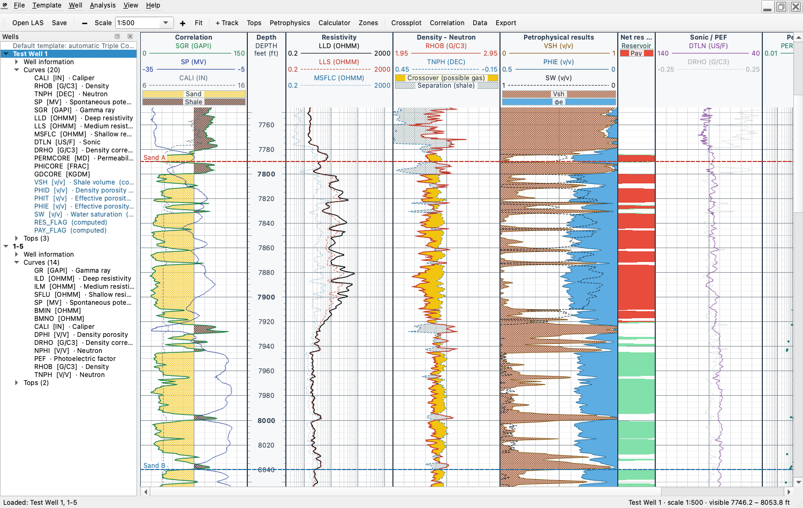
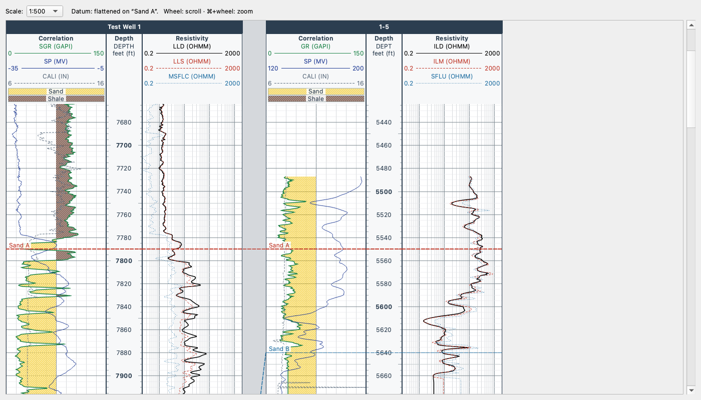
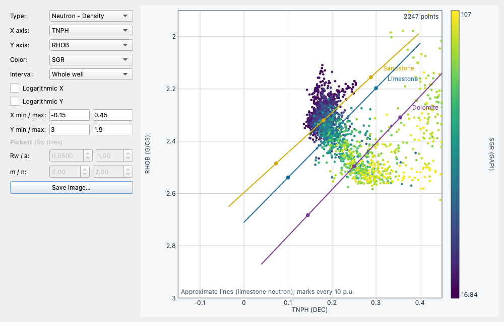

# InnoPetrol — Well Viewer

Well log viewer (**LAS 2.0** files) for petroleum engineers, written in Python with PySide6.

*English · [Español](README.es.md)*



## Features

**Display**
- Several wells open at once (windows or tabs), side tree with header info, curves and tops.
- Automatic **Triple Combo** template when a LAS file is opened: correlation (GR/SP/CALI with sand/shale fill), depth, resistivities (log), density-neutron with gas crossover, sonic/PEF, petrophysics and permeability.
- Recognizes about 125 mnemonics (17 curve families) from different service companies (GR/SGR/GRC, NPHI/TNPH, LLD/ILD/AT90…) and proposes scale, color and linear/log type.
- True vertical scales (1:200, 1:500, 1:1000…) or fit to window.
- Configurable tracks: curves, linear or logarithmic scale, color, width, style, fills between curves or against a fixed value with 10 patterns.
- **Backup (wrap-around) scales**: values beyond the scale are drawn again, dashed, on the next scale width (GR 150–300).
- **Fills colored by value** (gamma ray, resistivity, viridis, rainbow, grayscale color maps).
- **Volumes track**: stacked shale / matrix / hydrocarbon / water from the petrophysics results.
- Add, remove, move, rename and resize tracks (by dragging their border).
- **Units on demand**: View ▸ Unit system (as in the file / oilfield / metric) or per curve from the well tree
  (g/cm³ ↔ kg/m³, µs/ft ↔ µs/m, fraction ↔ %, °F ↔ °C, psi ↔ kPa, in ↔ mm). Stored data is never changed and
  calculations convert their inputs, so results do not depend on how each file was delivered.
- Interface in **English or Spanish**, switched live from **View ▸ Language / Idioma** (the first start uses the system language).

**Navigation** (on Mac, ⌘ instead of Ctrl)
- Zoom: the **−** / **+** buttons next to “Scale” (or Ctrl − / Ctrl +) step through standard scales; “Fit” shows the whole well (Ctrl 0); an exact scale can be typed in the “Scale” field, e.g. `1:300`.
- Continuous zoom at the cursor: Ctrl + wheel or trackpad pinch.
- Wheel: scroll · Shift + wheel: horizontal · PgUp/PgDn, Home/End.
- Cursor readout of depth, zone and every curve value in the status bar.
- Data table synchronized with the cursor.

**Interpretation**
- Formation tops: add with right-click, edit in a table, import/export CSV (English or Spanish column names).
- Petrophysics: Vsh (linear, Larionov), density and neutron-density porosity, effective porosity, Sw by **Archie, Simandoux or Indonesia**, reservoir and pay flags.
- **Parameters by zone** (between formation tops): clean/shale GR, matrix and fluid density, Rw, a, m, n, Rsh and cutoffs.
- **Rw at formation temperature** (Arps) from a geothermal gradient on TVD or a temperature curve.
- **Graphical parameter picking**: clean/shale GR dragging lines on the histogram, Rw dragging the water line on a Pickett plot (or fitted to the wettest clean points), for the whole well or one zone.
- **Undo / redo** (Ctrl+Z / Ctrl+Shift+Z) for track, template, tops, survey, curve and petrophysics changes, one history per well.
- Zone summary: gross, net reservoir and net pay thickness, N/G, average φ, Sw and Vsh (copy to Excel or CSV).
- Curve calculator with expressions (`(2.65 - RHOB) / 1.65`, `where(GR > 75, 1, 0)`) evaluated safely (no `eval`).
- Statistics and histogram per curve and zone (P10/P50/P90).
- Crossplots colored by a third curve: free, **neutron-density** with lithology lines and **Pickett** with Sw lines.
- **Base map** with well locations (from the header or entered by hand, X/Y or latitude/longitude,
  decimal or degrees-minutes-seconds) and survey trajectories; click wells to pick a correlation section.
- **Multi-well crossplots and histograms**: curves matched by name or family and converted to common
  units, zones by top name, colored by well, P10/P50/P90 per well.
- **Multi-well correlation** side by side, in depth or **flattened on a top**, with lines joining tops of the same name.
  **Pick tops by clicking** on each well (same name and color across wells, right-click to add or remove, Ctrl+Z).

**Files**
- JSON templates (`.ipt.json`): they apply to other wells even when those use different mnemonics. Configurable default template.
- Projects (`.ipproj`): wells, layouts, tops, parameters and computed curves (stored as formulas).
- **Autosave and crash recovery**: unsaved work is saved every 2 minutes and offered back after an
  unexpected exit. Errors are written to a log file and reported without closing the program.
- **Mnemonic aliases** editable by the user (Template ▸ Mnemonic aliases…), importable/exportable as JSON
  to share a company's naming.
- Export the log to **paginated PDF** or **PNG** at scale, with a **log heading** (company, field, service company, depth reference, elevation, survey), **LAS** (including computed curves) and **CSV**.

| Correlation flattened on a top | Neutron-density crossplot |
|---|---|
|  |  |

## Installation and usage

Runs on **Windows 10/11**, **Linux** (distributions with glibc 2.28 or newer: Ubuntu 20.04+,
Debian 11+, RHEL/Rocky 8+) and **macOS 12+**. No dedicated graphics card needed.

### Executable (no Python install)

In the repository's **Actions** tab on GitHub, every build produces, per system: a **Windows
installer** (`…-windows-setup.exe`, no administrator rights needed), a **macOS disk image** (`.dmg`,
drag to Applications) and a **Linux archive** (`.tar.gz` with `install.sh`), plus plain `.zip` files.

The executables are not signed yet: Windows SmartScreen warns the first time (“More info” ▸
“Run anyway”) and macOS asks to open it with right-click ▸ Open. See
[docs/DISTRIBUTION.md](docs/DISTRIBUTION.md) for what signing requires.

To build it by hand on the target machine:

```bash
uv sync --group build
uv run --group build python packaging/build.py     # output in dist/
```

### From source

Requires [uv](https://docs.astral.sh/uv/), which installs Python and the dependencies automatically:

```bash
uv sync
uv run innopetrol                          # start the application
uv run innopetrol samples/Testdata.las     # open one or more LAS files directly
```

On Windows (PowerShell) uv is installed with `irm https://astral.sh/uv/install.ps1 | iex`.

On Linux, Qt needs a few system libraries that desktop installs usually have; on a minimal
Ubuntu/Debian install:

```bash
sudo apt install libegl1 libgl1 libxkbcommon0 libxkbcommon-x11-0 libxcb-cursor0 libfontconfig1 libdbus-1-3
```

`.las` and `.ipproj` files can also be dragged onto the window. `samples/` contains four example wells.

### Lower-powered machines

The application measures how long drawing takes on each machine. If a full redraw is slow, zooming,
resizing the window or dragging a track border show a lightweight preview and the full-quality drawing
happens when the gesture ends. Moving the cursor and scrolling reuse what has already been drawn, so they
stay smooth on modest hardware too.

## Tests

```bash
uv run pytest
```

Interface tests run without opening windows (*offscreen* mode). GitHub Actions runs them on
Windows, Linux and macOS on every change, and also builds and tests each system's executable
(`.github/workflows/ci.yml`).

## Adding a language

Interface texts are written in English in the code and marked with `_()`; translations are standard
gettext catalogs in `innopetrol/locale/<language>/LC_MESSAGES/innopetrol.po`.

```bash
uv run python tools/i18n.py init fr     # create the catalog for a new language (e.g. French)
# translate innopetrol/locale/fr/LC_MESSAGES/innopetrol.po with a text editor or Poedit
uv run python tools/i18n.py compile     # compile .po -> .mo
```

Then add the language to `LANGUAGES` in `innopetrol/i18n.py`. After changing interface texts in the code,
`tools/i18n.py update` refreshes every catalog; the test suite fails if any text is left untranslated,
if a translation drops a `{placeholder}`, or if the compiled `.mo` is out of date.

## Layout

```
innopetrol/
  model/     pure data and calculations (no Qt): well, scales, layout, templates, mnemonics,
             calculator, petrophysics, tops, project
  render/    QPainter drawing, shared by the screen and the PDF/PNG export
  ui/        PySide6 windows and dialogs
  locale/    interface translations (gettext: editable .po + compiled .mo)
tests/       automated tests (pytest + pytest-qt)
packaging/   executable build with PyInstaller
samples/     example LAS files
```

The project's history and what changed from the 2020 version are described (in Spanish) in
[CAMBIOS.md](CAMBIOS.md).

## License

InnoPetrol is free software: you can redistribute it and/or modify it under the terms of the
**GNU Lesser General Public License, version 3 or later** (see [COPYING.LESSER](COPYING.LESSER) and
[COPYING](COPYING)). It is distributed WITHOUT ANY WARRANTY.

Third-party components: Qt for Python / PySide6 (LGPLv3), lasio (MIT), NumPy (BSD).
